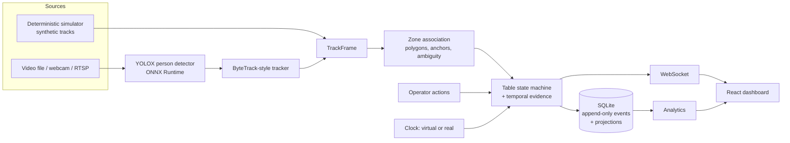

# TableWatch AI

**Know every table. Never miss a moment.**

TableWatch watches dining tables through cameras a restaurant may already have. It tracks which tables are free, which guests are still waiting for a server, and which tables need cleaning. Managers get one screen, one alert per problem, and analytics built from what actually happened.

This repository is a **locally runnable MVP**. It starts in a deterministic **simulation** of a fictional restaurant, so you can try every feature with no restaurant, no camera and no internet.

> **Honesty first.** Everything in demo mode is synthetic. Real person detection works on recorded video, but **nothing here has been tested on real restaurant CCTV**. See [Real-world validation status](#real-world-validation-status).

---

## What problem it addresses

Busy restaurants lose track of tables:

- Guests sit down and nobody notices them for ten minutes.
- A table sits dirty while a party waits at the host stand.
- Nobody knows actual wait, turnover or cleaning times.

TableWatch turns camera observations into table states, timers and alerts. Staff confirm service and cleaning with one tap. The camera alone never claims that a table was served or cleaned.

## One-command demo (Mac, Apple Silicon or Intel)

Prerequisites: **Python 3.11+** and **Node.js 18+** (`brew install python@3.12 node`).

```bash
./scripts/setup.sh        # once: creates backend/.venv, installs packages, initialises the local DB
./scripts/start-demo.sh   # starts backend + dashboard; Ctrl+C stops both
```

Open **http://127.0.0.1:5173**. The simulation starts playing at 5x.
Presentation mode for restaurant owners: **http://127.0.0.1:5173/demo**.

No account, no cloud, no Docker, no model download. After setup it works offline.

## Running tests

```bash
./scripts/test.sh          # pytest (backend) + TypeScript check + Vitest (frontend)
./scripts/test.sh --e2e    # also Playwright browser tests against the real backend
```

The e2e suite needs a Playwright Chromium (`cd frontend && npx playwright install chromium` once).
No test needs a camera, a GPU or the network.

## What you can do in the dashboard

| Page | What it does |
|---|---|
| **Overview** | KPI cards, clickable floor plan with status, timers and alert badges, attention list, live event feed |
| **Live Floor** | Same floor with simulated people and zones, full table panel: confirm service, confirm cleaning, acknowledge, correct status with a reason, verify uncertain tables |
| **Cameras** | Monitor (synthetic or real feed with zones, boxes, track IDs, confidence), **zone editor**, sources and processing modes |
| **Alerts** | Deduplicated alerts with filters, acknowledge, and resolve through valid actions; opt-in sound |
| **Analytics** | Occupancy by hour/weekday, heatmap, service response, cleaning and turnover, alerts over time, staffing estimator, CSV export |
| **Table History** | Per-table timeline; each event labelled Simulator / Computer vision / Operator / System |
| **Settings** | Validated thresholds, simulation defaults, privacy, retention and data deletion |
| **/demo** | Guided presentation with step tracking, before/after and "How it works" |

## Simulation scenarios

All five run through the **same state machine and event pipeline** as real video.

| Scenario | What happens |
|---|---|
| Guided demo | A short story for presentations: seating, a waiting alert, service, a departure, cleaning |
| A: Normal service | Arrive, serve, eat, leave, clean |
| B: Forgotten customers | Table 4 never gets a server; exactly one alert at 5 minutes |
| C: Slow table cleaning | Nobody buses Table 5; cleaning escalation; timeout never frees the table |
| D: Peak-hour rush | Eleven parties, one server; several waiting alerts at once and a cleaning backlog |
| E: Tracking problems | Dropouts, ID switches, occlusion, a wandering guest, overlapping zones, low confidence, a 60 s camera outage |

Speeds: paused, 1x, 5x, 10x, plus "+1 min". Reset replays a scenario exactly from its seed. Scenarios are YAML files in `demo/scenarios/`.

**Analytics → Generate synthetic week** builds 14 simulated lunch/dinner services (about 1–2 minutes in the background) so the hourly and weekday charts have something to show. It is labelled synthetic everywhere.

## Architecture



- `backend/tablewatch/core/` is pure Python: clocks, geometry, zones, the state machine, alerts and the engine. No FastAPI, OpenCV, React or model imports.
- `simulation/` drives the engine with synthetic `TrackFrame`s. `vision/` produces the same frames from real video.
- `storage/` keeps an append-only event log; sessions and alerts are projections rebuilt from it.
- `services/runtime.py` runs exactly one session (simulation, recorded or live) and keeps datasets apart.

More: [docs/architecture.md](docs/architecture.md) · [docs/state-machine.md](docs/state-machine.md)

## Technology stack

Python 3.11+, FastAPI, Uvicorn, Pydantic, SQLite (stdlib `sqlite3` repository layer), pytest ·
OpenCV, ONNX Runtime, YOLOX-Nano (Apache-2.0), an in-house ByteTrack-style tracker ·
React 18, TypeScript, Vite, Tailwind CSS, Lucide icons, Recharts · Vitest, Playwright.

## Adding a recorded video

1. Install vision support and the model (explicit, separate steps):
   ```bash
   ./scripts/setup.sh --vision
   ./scripts/download-model.sh        # YOLOX-Nano, ~3.6 MB, sha256-verified
   ```
2. Copy the video into `media/` (gitignored).
3. **Cameras → Sources → Add source → Video file**, confirm you are authorized.
4. **Cameras → Zone editor**: pick the camera, *Load frame*, draw one polygon per table seating area, assign tables, *Save*.
5. **Sources → Analyse video**. The dashboard switches to *Recorded video* mode with its own dataset.

Command-line analysis (no server needed):

```bash
cd backend
.venv/bin/python -m tablewatch.cli analyze --video ../media/lunch.mp4 --zones ../configs/zones/lunch.json [--annotate]
```

It writes `events.jsonl` and `summary.json` (measured speed, transitions, unresolved observations) to `demo/generated/`. `--annotate` also writes an annotated video; it is opt-in and stays local.

## Configuring a camera

Webcams and RTSP cameras are added on the **Cameras** page. For RTSP, prefer putting the URL in `.env` and entering only the variable name (`url_env`). URLs are validated, stored only in the local database, and always shown and logged redacted (`rtsp://***@host`). TableWatch never scans the network; it opens only sources you add. Details and the compatibility checklist: [docs/camera-integration.md](docs/camera-integration.md).

## Drawing table zones

Zones are **seating areas**, not tabletops: include where guests sit. Coordinates are normalized to 0–1. Choose the anchor by camera angle: *feet* (box bottom center) for angled cameras, *body center* for overhead ones. The editor validates point count, bounds, self-intersection, duplicate tables, unknown cameras and excessive overlap (>30%). Small overlaps are allowed; a person standing in one is treated as ambiguous and counted for neither table. *Test on live tracks* shows which current tracks fall in which zone before you save.

## Analytics explained

- **Occupancy rate** = occupied table-time ÷ observed table-time. Camera-offline time is removed from **both**; unknown is not empty.
- **Service response** = seated → *confirmed* service. Possible staff visits are reported separately and never count as service.
- **Cleaning turnaround** = needs cleaning → cleaning confirmed. **Table turnover** = guests left → table available.
- **Peak occupied tables** and the **staffing estimator** (peak ÷ your tables-per-server ratio) are an illustrative planning heuristic, not a recommendation.
- Simulated, recorded and live data are separate datasets and are never merged. There are no ROI or savings figures.

## Privacy model

No face recognition, no face embeddings, no identity, no cross-camera re-identification, no audio, no cloud upload, no telemetry. Raw video is never stored; only operational events are. The server binds to `127.0.0.1`, checks Host headers, and restricts CORS and WebSocket origins. Retention and per-dataset deletion are in **Settings**. See [docs/pilot-readiness.md](docs/pilot-readiness.md) for consent and signage.

## Third-party licensing

All runtime dependencies are MIT, ISC, BSD or Apache-2.0. The detector is YOLOX (Apache-2.0); no AGPL code or weights are included. Details and caveats (COCO training data, FFmpeg inside OpenCV wheels): [docs/licenses.md](docs/licenses.md).

## Real-world validation status

| Area | Status |
|---|---|
| State machine, alerts, storage, API, dashboard | **Working**, covered by automated tests |
| Simulation scenarios A–E + guided demo | **Simulated**, deterministic, tested |
| Person detection + tracking on real video | **Working on a real public pedestrian test video** (not a restaurant) |
| Table states from real restaurant CCTV | **Not verified**. No restaurant footage has been used |
| Webcam / RTSP live mode | **Implemented, not verified on physical cameras** (reconnect logic is unit-tested) |
| CoreML acceleration on Apple Silicon | **Attempted automatically, not verified** (built on Linux; CPU fallback tested) |
| Commercial readiness | **No.** This is a validation MVP |

Full list: [docs/limitations.md](docs/limitations.md) · progress log: [docs/build-progress.md](docs/build-progress.md)

## Next development priorities

1. Record (with permission) a short service in a real restaurant and annotate it with the ground-truth format; run `tablewatch.cli evaluate`.
2. Tune thresholds and anchors per camera angle from those measurements.
3. Authentication + HTTPS before any network exposure; multi-user roles.
4. Tablet-friendly staff view for one-tap confirmations.
5. Optional staff identification that respects privacy (e.g. uniform colour or a wearable beacon), validated before it can affect service status.

## Project layout

```
backend/tablewatch/  core/ simulation/ vision/ storage/ services/ analytics/ evaluation/ api/ config/ cli.py main.py
backend/tests/       pytest suite (no camera required)
frontend/src/        components/ pages/ hooks/ services/ types/ lib/ styles/
frontend/e2e/        Playwright flows against the real backend
configs/             restaurant.yaml, thresholds.yaml, cameras.yaml, zones/
demo/scenarios/      simulation scenarios (YAML)
scripts/             setup.sh, start-demo.sh, test.sh, download-model.sh
docs/                architecture, state machine, demo guide, cameras, pilot readiness, limitations, licenses
```
