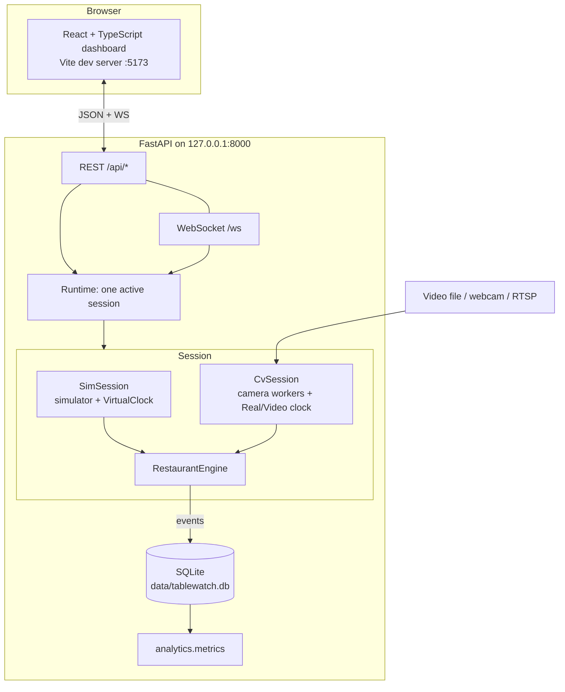

# Architecture

## Packages (`backend/tablewatch`)

| Package | Responsibility | Depends on |
|---|---|---|
| `core/` | clocks, geometry, zones, models, thresholds, state machine, alerts, engine | stdlib only |
| `simulation/` | scenarios (YAML), agent simulator, `SimSession`, synthetic history | core |
| `vision/` | sources (file/webcam/RTSP), YOLOX ONNX detector, tracker, threaded camera workers | core, optional numpy/OpenCV/onnxruntime |
| `storage/` | SQLite migrations, append-only events, projections, config versions | core |
| `analytics/` | metrics from sessions, alerts and events | stdlib |
| `services/` | `Runtime` (mode switching, loop tick, read models), versioned settings | all above |
| `api/` | FastAPI routes, WebSocket hub | services |
| `evaluation/` | ground-truth comparison for pilots | stdlib |
| `cli.py` | `serve`, `init-db`, `analyze`, `simulate`, `evaluate` | all |

The four interfaces the spec asks for:

| Interface | Implementation |
|---|---|
| `detect(frame) -> detections` | `YoloxOnnxDetector.detect` (any object with `detect` works) |
| `update(detections, t) -> tracks` | `ByteTracker.update` |
| `process(tracks, zones) -> observations` | `ZoneAssigner.observations(frame)` |
| `evaluate(observations, actions, clock) -> events` | `RestaurantEngine.ingest / act / tick(t)` |

## Data flow per step

1. A source produces a `TrackFrame` (camera, domain time `t`, tracked people with normalized boxes and confidence, source label).
2. `ZoneAssigner` maps each person's anchor to at most one table zone.
3. Each table's `TableStateMachine.observe` updates evidence and may emit events.
4. `engine.tick(t)` applies time rules (alerts, camera staleness) even when no frame arrived.
5. Events go to subscribers: SQLite (`Store.append_event`, idempotent by key) and the WebSocket outbox.
6. The loop (every 100 ms) broadcasts events, a snapshot (≥ every 0.5 s) and camera frames to clients.

## Clocks

`core/clock.py`: `RealClock` (monotonic), `VirtualClock` (simulation: pause, resume, 1/5/10x, reset), `ManualClock` (tests), plus `VideoClock` in the runtime (domain time = video position). The core never reads the system clock; all timing comes from `t`. The simulator advances in fixed 0.5 s steps; the virtual clock only decides how many steps to run, so speed changes never change outcomes.

## Datasets and runs

`runs.dataset ∈ {simulation, recorded, live}`. Every session (each simulation reset, each video analysis, each live start) is a separate run. Analytics, alerts and events are always queried per dataset. Resetting the simulation creates a new run; it never deletes anything, and deleting simulation data never touches live data (`test_simulation_reset_never_touches_live_data`).

## Database (SQLite, WAL)

`restaurants, cameras, table_zones, runs (+ view simulation_runs), events, table_sessions, alerts, operator_actions, configuration_versions, schema_version`. Migrations are additive and run at startup without dropping data. `Store.rebuild_projections()` recomputes sessions and alerts from events.

## Concurrency

The engine runs on the asyncio loop thread; API handlers call it synchronously, so there are no races. Camera workers run a reader thread and an inference thread each, with a one-slot "latest frame" buffer that drops stale frames, and push `TrackFrame`s through a bounded queue. Synthetic-history generation uses its own SQLite connection in a background thread.

## Security

Binds to 127.0.0.1 by default (warns loudly otherwise). `TrustedHostMiddleware` blocks DNS-rebinding hosts. CORS and WebSocket origins are an allow-list. Mutations require JSON bodies. Video paths must resolve inside `media/`. RTSP URLs are validated and redacted in API responses, logs and errors. Unhandled errors return a redacted message, never a stack trace.
