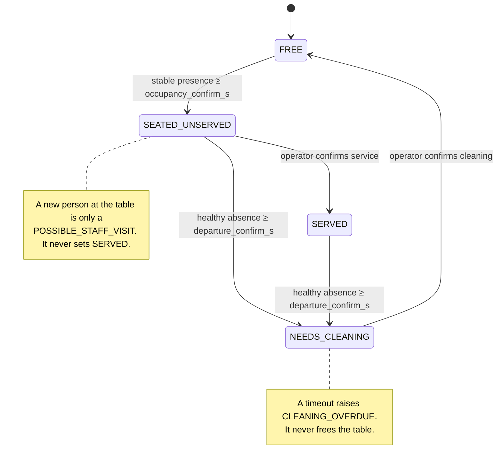

# Table state machine

Source: `backend/tablewatch/core/state_machine.py`, `core/engine.py`, `core/alerts.py`.
Tests: `backend/tests/test_state_machine.py`, `test_engine.py`, `test_simulation.py`.

## States

`OFFLINE`, `DEGRADED`, `LOW_CONFIDENCE` and `UNKNOWN` are **observation health**, shown next to the state. They are never treated as proof that a table is empty.

## Two layers

| Layer | What | Persisted | After a restart |
|---|---|---|---|
| `TableProjection` | state, session, seated/served/left/cleaning times | yes, rebuilt from the event log by `reduce(projection, event)` | exact |
| `Evidence` | seating candidate, absence accumulator, which track IDs are guests, low-confidence episode | no | starts empty; can only delay transitions, never invent them |

Every state change is an `Event`. The machine updates itself through the same reducer used for replay, so live state and replayed state cannot diverge (`test_reduce_rebuilds_projection_exactly`, `test_replay_after_restart_rebuilds_state_and_alerts`).

## Rules

**Seating (FREE → SEATED_UNSERVED).** A track counts as presence only if its anchor is inside the zone, it is not ambiguous, and its confidence ≥ `detection_confidence`. A candidate starts on first presence and survives gaps shorter than `lost_track_grace_s`. After `occupancy_confirm_s` the table is seated. `seated_t` is when the guests sat down (candidate start), not when the system was sure, so waiting time is honest. The event records guest count, initial track IDs, evidence quality (share of observations with presence) and mean confidence.

**Departure (occupied → NEEDS_CLEANING).** The absence timer only grows on observations that are healthy (`OK`), contain no uncertain tracks, and arrive less than `max_observation_gap_s` after the previous one. Any confident presence resets it. Low-confidence or ambiguous tracks, degraded/offline cameras, and long gaps all **freeze** it. When it reaches `departure_confirm_s`, the table needs cleaning. `left_t` is the last time a guest was seen. If the absence window included an outage, the event is flagged `during_observation_gap`.

**Service.** Only `CONFIRM_SERVICE` (operator, or the simulator's simulated staff tablet, labelled `simulator`). Confirming twice is rejected.

**Cleaning.** Only `CONFIRM_CLEANING`. Timeouts escalate; they never clean.

**Possible staff visits.** A non-guest track that stays between `min_visit_s` and `max_visit_s` and leaves *while the party stays* is logged as `POSSIBLE_STAFF_VISIT` (or a possible cleaning visit at a dirty table). It is information, not service. A visitor who stays longer than `max_visit_s` joins the party.

**Track identity.** When a new track ID appears within `reassociation_distance` of a guest lost less than `reassociation_window_s` ago, it is re-linked to that guest. After a camera outage, guests are treated as lost "now" so returning tracks re-link by position.

**Zones.** Each person is assigned to at most one zone. Inside two zones, the deeper one wins if it is deeper by `ambiguity_margin`; otherwise the person is ambiguous for both and counts as presence for neither.

**Corrections.** `CORRECT_STATUS` needs a reason. It never deletes a session.

| From → To | Effect |
|---|---|
| FREE → SEATED_UNSERVED / SERVED | Opens a new corrected session. Auto-departure waits until the camera actually sees someone (blind spots never override the operator). |
| occupied → NEEDS_CLEANING | Records departure now; cleaning alert raised. |
| occupied / NEEDS_CLEANING → FREE | Closes the session as corrected (kept in history). |
| NEEDS_CLEANING → occupied | Reopens the same session (false departure). Must match whether service was confirmed. |
| SEATED_UNSERVED → SERVED | Rejected: use Confirm service. |
| SERVED → SEATED_UNSERVED | Rejected: a confirmed service cannot be un-confirmed. |

## Alerts

| Alert | Raised | Resolved by | Dedup key |
|---|---|---|---|
| `UNSERVED_TOO_LONG` (warning) | `now − seated_t ≥ unserved_warning_s` | service confirmed, departure, correction | `UNSERVED:<session>` |
| `TABLE_NEEDS_CLEANING` (info) | departure | cleaning confirmed, correction | `CLEAN:<session>` |
| `CLEANING_OVERDUE` (warning) | `now − cleaning_required ≥ cleaning_overdue_s` | cleaning confirmed, correction | `OVERDUE:<session>` |
| `CAMERA_OFFLINE` (critical) | no frames for `camera_offline_after_s` | frames resume | `CAM:<camera>:<outage#>` |
| `LOW_CONFIDENCE_OBSERVATION` (warning) | uncertain evidence for `low_confidence_alert_s` | clean evidence for `low_confidence_clear_s`, or operator verifies | `LOWQ:<table>:<start>` |

A dedup key can be raised once, ever. That is why an alert cannot repeat every frame and cannot re-fire after it was resolved for the same visit. Acknowledging does not resolve. Alert IDs are a hash of run + key, so identical runs give identical IDs.

## Failure modes and how they are handled

| Disturbance | Behaviour | Test |
|---|---|---|
| One missed detection | Nothing changes | `test_single_missed_detection_is_harmless` |
| Occlusion < departure window | Table stays occupied | `test_temporary_occlusion_does_not_end_session` |
| Track ID switch | Re-linked; no phantom visit | `test_track_id_change_is_reassociated_not_a_visit` |
| Passer-by / guest near another table | No seating | `test_passerby_does_not_seat_table`, `test_guest_walking_past_other_table_does_not_seat_it` |
| Person in overlapping zones | Counted for neither; uncertainty alert | `test_person_in_overlap_is_not_counted_twice` |
| Blurry / low confidence | Never seats, never frees; uncertainty alert | `test_low_confidence_tracks_never_seat_and_never_free` |
| Camera offline | State frozen, CAMERA_OFFLINE alert, departure only after a full healthy window on return | `test_camera_offline_never_frees_a_table` |
| Sparse / long gaps in observations | Gaps are not absence | `test_unobserved_gaps_do_not_count_as_absence` |
| Duplicate request | Same result, applied once | `test_duplicate_requests_are_idempotent` |
| Server restart | State and alerts rebuilt from events | `test_state_reconstructed_from_sqlite_after_restart` |

### Known weaknesses (not solved)

- A staff member who stands at an empty table longer than `occupancy_confirm_s` will seat it.
- Guests who return from the restroom with a new track ID long after `reassociation_window_s` are first treated as visitors (they join the party after `max_visit_s`).
- Departure detection is deliberately slow (default 90 s). Faster means more false departures.
- In a busy non-restaurant scene (tested on a public pedestrian video), people standing still in a zone for 30 s seat it. Zones must cover seating areas only.

## Thresholds

All in `configs/thresholds.yaml`, editable in Settings, validated by `core/thresholds.py` (ranges plus cross-checks such as grace < departure window). Saved versions are stored in `configuration_versions` and each run records the thresholds it started with.
